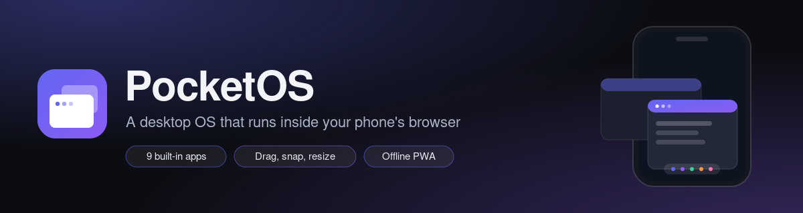

<div align="center">



&nbsp;

[](https://github.com/AnwarDebes/PocketOS/releases)
[](LICENSE)


**[Open the live demo](https://anwardebes.github.io/PocketOS/)**: best on a phone, or resize the window to watch the windowing adapt.

</div>

# PocketOS

A web based desktop environment that turns a phone's browser into a desktop class computer. PocketOS is a windowing shell, a virtual filesystem, a process and app model, and a set of built in apps, all running client side and installable to the home screen as a Progressive Web App.

It is not a kernel and it does not boot on hardware. It is a desktop experience simulated in the browser with TypeScript and standard web APIs, designed to make real "computer" workflows possible on a phone: overlapping windows, file management, a terminal, and side by side editing.

> Status: complete. All seven build phases are done. See [PROGRESS.md](./PROGRESS.md) for the full breakdown.

## Why

Phones are powerful, but the mobile UX blocks desktop workflows. There is no real multitasking with windows, file management is weak, there is no terminal, and you cannot comfortably edit text and code side by side. PocketOS puts a desktop shell on top of the browser so those workflows become possible, works offline, and installs full screen so it launches like a native app.

## Core idea: adaptive windowing

A small screen cannot use floating windows, so PocketOS adapts at runtime to the viewport:

- **Desktop mode** (wide screens, tablets, or a phone plugged into a monitor): true draggable, resizable, overlapping windows with snap to edge tiling.
- **Mobile mode** (narrow phones): apps open maximized and you switch between them through an app switcher, like a phone's recent apps view, with an optional split view.

The transition between the two is smooth when the viewport changes, for example when rotating the phone or connecting a display. This is the feature that makes a desktop genuinely usable on a phone.

## Tech stack

- React 18 + TypeScript (strict mode)
- Vite build tooling
- Tailwind CSS with runtime design tokens
- Zustand for global state (window manager, processes, settings)
- Dexie (IndexedDB) for the persistent virtual filesystem and app data
- vite-plugin-pwa (Workbox) for the service worker, offline caching, and install
- xterm.js for the terminal
- Monaco Editor for the code editor, lazy loaded and runtime cached
- Framer Motion for animation
- lucide-react for icons

No backend, no auth, no API keys. Everything runs in the browser and persists locally. It deploys as a static site.

## Getting started

Requirements: Node 18+ and npm.

```bash
npm install        # install dependencies
npm run icons      # generate the PWA icons into public/ (already committed)
npm run dev        # start the dev server at http://localhost:5173
```

The dev server binds to the local network too, so you can open it on a phone using the machine's LAN address that Vite prints.

### Production build

```bash
npm run build      # typecheck, then build to dist/
npm run preview    # serve the built site (this is where the service worker and offline behaviour run)
```

`dist/` is a static bundle. Deploying to Vercel needs no configuration changes; Netlify works the same way.

For a GitHub Pages project site, which is served from a sub-path, set the base path at build time:

```bash
BASE_PATH=/PocketOS/ npm run build
```

The workflow in [`.github/workflows/pages.yml`](.github/workflows/pages.yml) does this on every push to `main` and publishes the [live demo](https://anwardebes.github.io/PocketOS/).

### Other scripts

| Script | What it does |
| --- | --- |
| `npm run typecheck` | Type check with no emit |
| `npm run lint` | ESLint over the source |
| `npm run format` | Prettier write |
| `npm run icons` | Regenerate PWA icons from the vector mark |

## Architecture

The code is organized around core systems rather than one big blob.

```
src/
  kernel/      window manager, process registry, focus and z-order, event bus
  fs/          virtual filesystem layer (Dexie backed), path utils, file ops
  store/       zustand stores (windows, processes, settings, fs cache)
  shell/       boot, lock screen, desktop, taskbar/dock, launcher, app switcher
  windowing/   Window component, title bar, resize handles, snapping, mobile mode
  apps/        one folder per built in app, each registers in the app registry
  components/   shared UI primitives
  hooks/        shared hooks
  lib/          helpers and constants
  styles/       global styles and design tokens
```

Three systems are designed deliberately:

- **Window manager (kernel)** owns every open window and its geometry, z-order, and focus, and handles the difference between desktop mode and mobile mode.
- **Process and app model**: opening an app creates a process. Some apps are single instance, others allow multiple windows. Apps receive a launch payload, for example a file path to open.
- **App registry** is the single source of truth for app metadata, so the launcher, the dock, and "open with" all stay in sync.

Design tokens (color, spacing, radius, typography) live in one place. Colors are CSS variables consumed through Tailwind, so the whole OS can be re-themed at runtime (dark and light, plus accent) without a rebuild. Dark is the default.

## Adding a new app

Everything flows through one registry, so adding an app takes two steps:

1. Create a folder under `src/apps/<app-id>/` with an `index.tsx` that default-exports a component taking `AppProps` (`windowId` and an optional launch `payload`).
2. Register it in `src/apps/registry.ts` with its id, name, icon, default window size, single-instance flag, and (optionally) a `handlesFile` predicate for "open with".

That one registration makes the app appear in the launcher, the dock, and the home screen, and become a valid "open with" target. The component is lazy-loaded automatically. No other wiring is required.

## Built-in apps

Files, Text Editor, Terminal, Code Editor (Monaco), Browser, Calculator, Notes, Image Viewer, and Settings.

## Roadmap

- [x] Phase 0: scaffold and tooling
- [x] Phase 1: shell (boot, lock screen, desktop, dock, launcher, status area)
- [x] Phase 2: window manager (desktop and mobile modes, drag, resize, snap, app switcher)
- [x] Phase 3: virtual filesystem, File Manager, Text Editor, Terminal, Settings
- [x] Phase 4: Code Editor, Browser, Calculator, Notes, Image Viewer
- [x] Phase 5: persistence, device upload, full VFS export and import
- [x] Phase 6: mobile polish (gestures, split view, safe areas, orientation)
- [x] Phase 7: theming, install prompt, offline verification, performance and accessibility

## License

MIT.
